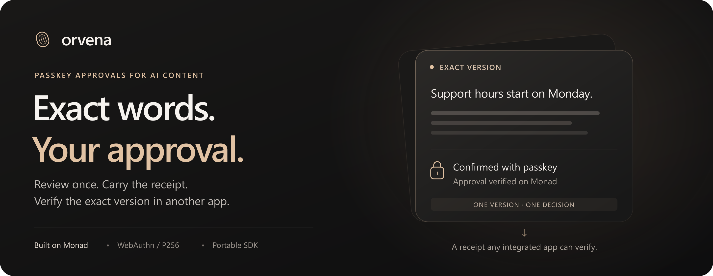
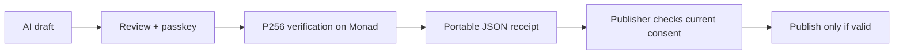

<p align="center">
  <a href="https://orvena-ashy.vercel.app"></a>
</p>

<p align="center">
  <strong>A human approves the exact draft. Another app verifies the decision.</strong>
</p>

<p align="center">
  <a href="https://orvena-ashy.vercel.app">Try Orvena</a> ·
  <a href="https://youtu.be/xs9y3Z6uXaM">Watch the demo · 2:33</a> ·
  <a href="https://youtu.be/7hhqMcqZgyI">Watch the pitch · 1:48</a> ·
  <a href="docs/INTEGRATION.md">Integrate the SDK</a>
</p>

Orvena is a **passkey approval protocol for AI publishing tools**. It records consent to an exact text version on Monad and returns a portable receipt. Any integrated application can independently check the approved text, its authorized approver and current revocation state before publishing.

Built by **Efeberk Zorlukol**, solo developer, for **Monad Metropolis — Trust, Identity & AI Infrastructure**. Live on **Monad testnet, chain 10143**. The contract and TypeScript SDK are the reusable infrastructure; the approval app and separate publisher demonstrate it.

## The problem, in one sentence

A manager approves “Our support hours start on **Monday**”; a downstream tool publishes “Our support hours start on **Tuesday**.” The person logged in, but the published words no longer match their decision.

Orvena binds approval to the exact UTF-8 bytes. The original version can pass a current verification; the changed version cannot. If the owner revokes approval, the original fails too.

The first target users are **developers of AI-assisted customer announcement and support publishing tools**. They can carry a human decision between drafting and publishing systems without building their own WebAuthn verification, receipt format and shared revocation layer.

## See the working product

| Open | What to inspect |
| --- | --- |
| [Live approval app](https://orvena-ashy.vercel.app/#app) | Create/unlock a passkey, review the draft, approve, download its receipt, revise or revoke. |
| [Separate publisher](https://orvena-publisher.vercel.app) | Request approval through the SDK popup or import a receipt; check current state before the demo publication step. |
| [Public verifier](https://orvena-ashy.vercel.app/verify) | Check content, expected approver and revocation directly from Monad, without signing in. |
| [Technical demo · 2:33](https://youtu.be/xs9y3Z6uXaM) | Real Windows device passkey creation, approval and revocation; changed text rejected; receipt used at another HTTPS origin. |
| [Pitch · 1:48](https://youtu.be/7hhqMcqZgyI) | Problem, solo developer, protocol, target users and next integrations. |

**Try the full flow:** use a passkey provider with WebAuthn PRF and user verification. Create a passkey, approve the prepared draft, then verify its receipt with the original text and your account address. Change a word and check again. Revoke with a fresh device confirmation, then recheck the original. The testnet sponsor pays gas; users need no seed phrase, wallet extension or test MON.

**Try verification without a passkey:** follow the [judge walkthrough](docs/JUDGES.md) using our recorded public receipt. Its expected result is **revoked**. This path needs no authenticator or sponsor and shows that consent can be withdrawn. The demo uses a prepared AI draft; no live model is connected.

## Why Monad, and why a protocol?

Monad's **native P256 precompile** allows the contract to verify the WebAuthn assertion for each approval and revocation. The chain checks the action itself; the gas sponsor cannot substitute its own signature for the user's content decision. **Mera** derives the enrollment account from the passkey's PRF output.

A conventional database is appropriate inside a single trusted application. Orvena addresses the handoff between applications: the receipt and shared chain state let a publisher verify the decision without trusting the drafting application's private database or contacting Orvena's API. Content remains offchain; the contract stores a salted commitment, owner, version link and approval/revocation timestamps.

Verification is portable. **Passkey issuance remains bound to its original RP/domain**, and readers still depend on Monad RPC. The prototype does not claim universal recovery or removal of every hosting dependency.

## How approval travels



| Decision | Result |
| --- | --- |
| Same bytes, trusted approver, active approval | `valid` |
| A word or whitespace changes | `content-mismatch` |
| Another account approved it | `wrong-approver` |
| Owner withdrew consent | `revoked` |
| No such approval exists | `not-found` |

Wrong deployment/network, malformed input or RPC failure throws an error. Integrations must fail closed and check again at their actual publishing boundary. A revision may link to an earlier approval by the same owner; it requires a new assertion.

## Evidence you can inspect

| Claim | Evidence |
| --- | --- |
| Deployed protocol on Monad testnet | [Deployment metadata](deployments/approvals-10143.json) · [Deployment transaction](https://testnet.monadscan.com/tx/0x437467c367d0c641c61c14adcc863e4fdf69745bb8ca52cff64282f1f5406563) |
| Real device approval and revocation | [Recorded device evidence](deployments/physical-passkey-10143.json) · [Approval transaction](https://testnet.monadscan.com/tx/0xe6e251ae8d0cc7530d215b38a5fcb44b0df313fc263bc08ae41de53ffc0caea9) · [Revocation transaction](https://testnet.monadscan.com/tx/0xf7ec0ea7420247494b6b9bb09b47024953f9cabd3d8f72fd6a6573b5ad50ff51) |
| Positive and negative behavior through the public HTTPS sponsor | [12 integration checks / 4 testnet transactions](deployments/approval-integration-vercel-10143.json): registration, approval, linked revision, revocation, changed text, unexpected owner, wrong deployment, replay and origin rejection. Assertions in this suite are synthetic. |
| Additional testnet protocol integration | [12 checks / 4 transactions](deployments/approval-integration-10143.json), also synthetic P256 fixtures. |
| 23 automated tests | [12 contract tests](packages/contracts/test) · [4 browser crypto/auth tests](apps/web/test) · [3 SDK tests](packages/sdk/test) · [4 sponsor/API tests](apps/relayer/test). Run `npm test`. |
| Verification works outside the Orvena API | [Standalone Node verifier](examples/verify-approval.mjs) and a packed SDK tested in a separate consumer. |

Physical device evidence and synthetic cryptographic fixtures are separate. Typecheck, contract compilation and production builds passed. Tests are not an external audit. Our publisher is a project-owned reference integration; **no independent customer adoption is claimed**.

## Integrate in your application

Build and pack the SDK with `npm run pack:sdk`, then install `.local/packages/orvena-sdk-0.1.0.tgz` in your application. The package is **not published on npm**.

```ts
import { requestContentApproval, createApprovalReader } from '@orvena/sdk';

// Your application determines the authorized account independently.
// Call this from a user click and keep exactDraft unchanged.
const receipt = await requestContentApproval({
  approvalUrl: 'https://orvena-ashy.vercel.app',
  content: exactDraft,
  expectedOwner: authorizedAccount,
});

const reader = createApprovalReader({
  address: '0x542ed99e33509dfecc7c4fc2d5293bf427cf91ba',
  chainId: 10143,
});

// Check at the authoritative publication boundary, usually on your server.
const result = await reader.verifyApproval({
  content: exactDraft,
  approvalPackage: receipt,
  expectedOwner: authorizedAccount,
});
if (result.status !== 'valid') throw new Error(result.status);
// Publish these same bytes after this fresh check.
```

The receipt contains `schema`, `chainId`, `contract`, `owner`, `approvalId` and `salt`. It carries no plaintext content or private key. Pin the chain/contract and authorized account yourself; a receipt cannot establish who your organization trusts.

See the [integration guide](docs/INTEGRATION.md), [SDK API](packages/sdk/README.md) and [live developer guide](https://orvena-ashy.vercel.app/developer). The browser publisher demonstrates a publishing gate; a real service must enforce that gate on its authoritative backend.

## Run locally

Use **Node 24** and npm. From a fresh clone:

```bash
git clone https://github.com/efeberk21/orvena.git
cd orvena
npm ci
npm run dev:local
```

This launches a local EVM, deploys the contracts and starts the sandbox at **http://localhost:5174**. It creates an isolated `.env.sandbox` with public local development credentials; no faucet or public-chain funds are needed. Never use those credentials on a public network. Localhost is a valid WebAuthn context, but authenticator PRF support is still required.

On Windows, `scripts/run.ps1 ci` and `scripts/run.ps1 dev:local` select the bundled Node 24 runtime if available. For testnet development, configure a new `.env` from [.env.example](.env.example), provide a dedicated funded testnet sponsor, then use `npm run compile` and `npm run dev`. Keep private keys in server-only variables. [Hosting and sponsor setup](docs/VERCEL.md).

<details>
<summary><strong>Commands and repository map</strong></summary>

| Command | Purpose |
| --- | --- |
| `npm run check` | Typecheck, compile, automated tests and production builds. |
| `npm run test:local` | HTTP protocol integration against the running local sandbox. |
| `npm run test:integration` | Configured testnet integration; spends sponsored test MON. |
| `npm run pack:sdk` | Build the SDK and produce a portable tarball. |
| `npm run verify:bundle` | Check browser assets for configured server signing secrets. |
| `npm run doctor` | Network and positive/negative native P256 checks. |

| Path | Responsibility |
| --- | --- |
| [packages/contracts](packages/contracts) | Key registry and approval/revocation contracts. |
| [packages/sdk](packages/sdk) | Receipt schema, popup requests and independent verification. |
| [apps/web](apps/web) | Approval app, public verifier and developer guide. |
| [apps/dapp](apps/dapp) | Separate-origin publisher reference integration. |
| [apps/relayer](apps/relayer) | Fixed-target testnet gas sponsor and Vercel adapter. |
| [deployments](deployments) | Addresses and actual testnet evidence. |
| [submission](submission) | Submitted text, videos, deck and delivery evidence. |

</details>

## Security and prototype boundaries

- **Fresh consent:** signatures bind action, content commitment/approval ID, owner, parent, nonce, deadline, chain and contract. The contract verifies the registered P256 key, RP/origin and user presence/verification. No approval-contract admin, upgrade mechanism or fund custody exists.
- **Key handling:** the P256 credential key stays with the authenticator/provider. Mera's PRF-derived software EVM key briefly exists in browser memory for enrollment. Recovery needs the same credential, compatible PRF/provider and original RP/domain. No cross-device recovery claim is made.
- **Content privacy:** text and random salt are offchain. Sharing a receipt shares its salt; recipients can test guesses about predictable text. Onchain owners, commitments and timestamps are public. This is not zero knowledge.
- **Publishing and revocation:** consent does not establish factual accuracy, authorship, AI model provenance, legal identity or organizational authority. Revocation affects later checks; it cannot recall already distributed content. State may change between verification and an external publication.
- **Operations:** protect the approval origin against malicious code. Public testnet sponsorship is capped; Vercel rate limits and nonce queues are per instance. Production requires durable shared coordination and stronger abuse controls.

Full [security model](docs/SECURITY.md) · [passkey compatibility](docs/PASSKEY-SUPPORT.md) · [current delivery status](docs/STATUS.md).

## First users and next integrations

The first pilot targets three developer teams building AI customer announcements or support publishing workflows. They would integrate the popup request and backend verification, then test a modified draft and a revoked receipt. **This is the acquisition plan, not existing traction.**

Measure time to first verified approval, completion rate, altered/revoked versions blocked, verification latency and sponsor cost. Use those results to improve the SDK and production sponsor. Potential revenue is managed sponsorship and integration support; independent verification remains available through the contract and SDK.

The current repository is publicly inspectable, with Solidity files marked MIT. A repository-wide license and npm publication are still release tasks before broad third-party distribution.
